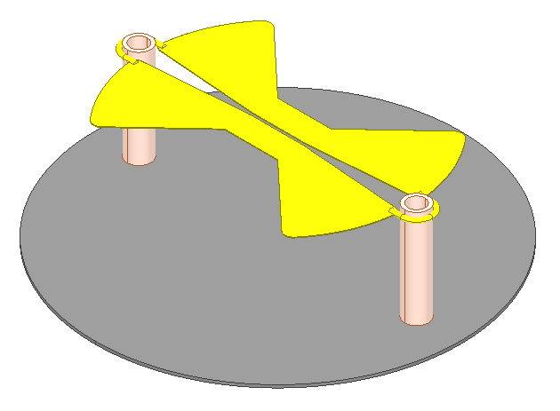
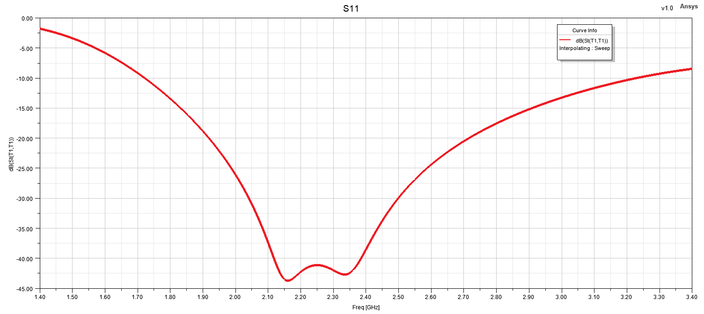
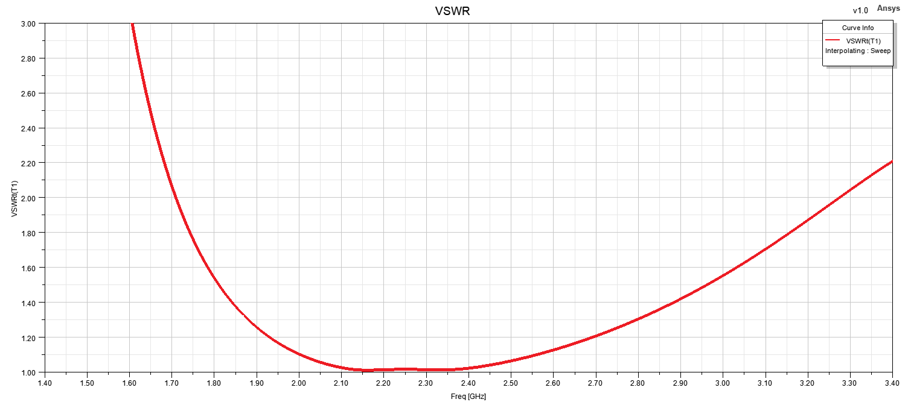
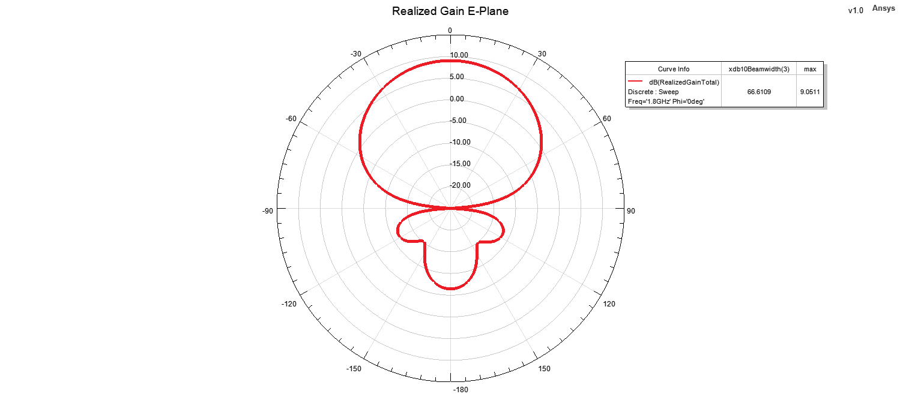
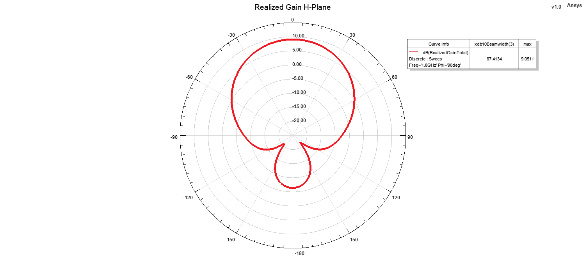
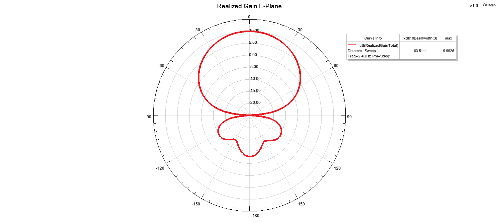
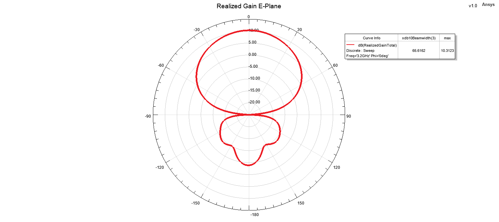
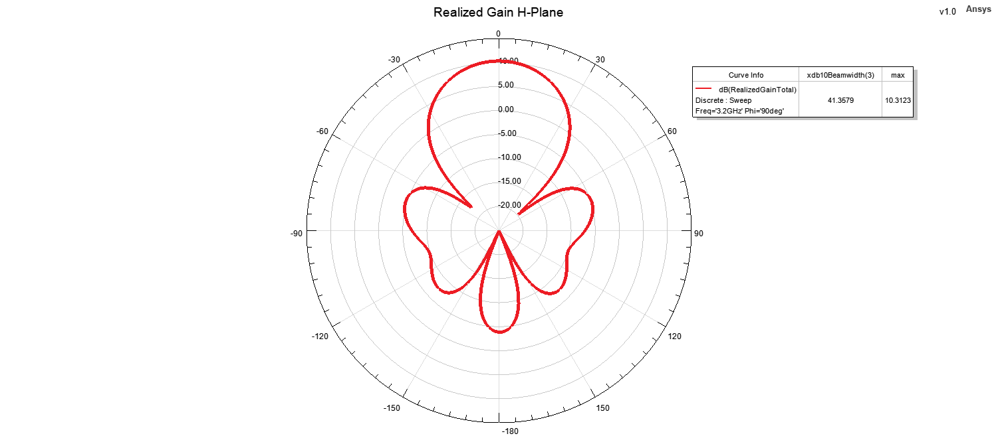

# Batwing Antenna - Design 1

## Overview

This design presents a broadband batwing antenna developed and analyzed using ANSYS HFSS.  

The antenna geometry is based on a flared dipole-like structure intended to provide wideband impedance behavior and relatively stable radiation characteristics over the operating frequency range.

The design was evaluated in terms of input matching, VSWR, realized gain, two-dimensional radiation patterns and three-dimensional far-field radiation characteristics.

## Key Features

- **Simulation Tool:** ANSYS HFSS
- **Antenna Type:** Batwing Antenna
- **Operating Band:** L-S Band
- **Polarization:** Linear
- **Radiation Characteristic:** Uni-Directional
- **Main Performance Parameters:** S11, VSWR, realized gain and radiation patterns
- **Radiation Pattern Evaluation Frequencies:** 1.8 GHz, 2.4 GHz and 3.2 GHz
- **3D Radiation Pattern:** Evaluated at 2.4 GHz

## Materials

- **Radiating Element:** Copper
- **Surrounding Medium:** Air / free-space simulation region
- **Ground / Supporting Structure:** Aluminum / ABS

## 3D Model

## Reflection Coefficient

## VSWR

## Realized Gain

## Radiation Patterns

### 1.8 GHz

  
  

### 2.4 GHz

  
  

### 3.2 GHz

  
  

## 3D Radiation Pattern

