# 0.8–15 GHz Wideband Discone Antenna

## Overview

This design presents an ultra-wideband Discone antenna developed and analyzed using ANSYS HFSS for operation from approximately 0.8 GHz to 15 GHz.

The antenna is a fully metallic structure from copper and consists of the characteristic disc-and-cone geometry of a conventional Discone antenna. This configuration provides very wide impedance bandwidth and omnidirectional radiation characteristics over a broad frequency range.

Due to the 360° rotational symmetry of the antenna structure, only one-quarter of the complete antenna geometry was used in the electromagnetic simulation. Appropriate symmetry boundary conditions were applied to the cut planes in order to reproduce the electromagnetic behavior of the full antenna.

This symmetry-based simulation approach significantly reduced the computational domain, mesh size and simulation time while preserving the electromagnetic behavior of the complete structure.

The antenna performance was evaluated using reflection coefficient, VSWR, realized gain, azimuth and elevation radiation patterns, and three-dimensional far-field radiation patterns at multiple frequencies across the operating band.

## Key Features

- **Simulation Tool:** ANSYS HFSS
- **Antenna Type:** Discone Antenna
- **Operating Frequency Range:** 0.8–15 GHz
- **Bandwidth Characteristic:** Ultra-Wideband
- **Polarization:** Linear
- **Radiation Characteristic:** Omni-directional
- **Structure Type:** Fully Metallic
- **Simulation Model:** Quarter-Symmetry Model
- **Symmetry Approach:** Appropriate electromagnetic boundary conditions applied to the symmetry planes
- **Main Performance Parameters:** S11, VSWR, realized gain and radiation patterns
- **Radiation Pattern Evaluation Frequencies:** 1, 3, 5, 7, 9, 11, 13 and 15 GHz
- **Analyzed Planes:** Azimuth and Elevation

## Materials

- **Disc Element:** Copper
- **Conical Element:** Copper
- **Supporting / Conductive Elements:** Copper
- **Surrounding Medium:** Air / free-space simulation region
- **Simulation Environment:** ANSYS HFSS

## 3D Model

<table>
<tr>
<td align="center">
   
</td>
<td align="center">
  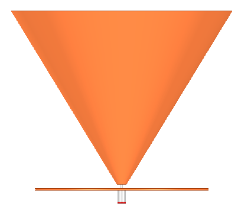 
</td>
</tr>
</table>

## Reflection Coefficient

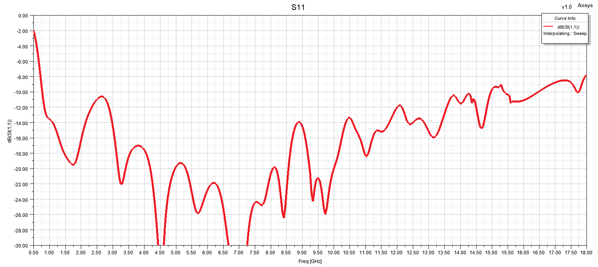

## VSWR

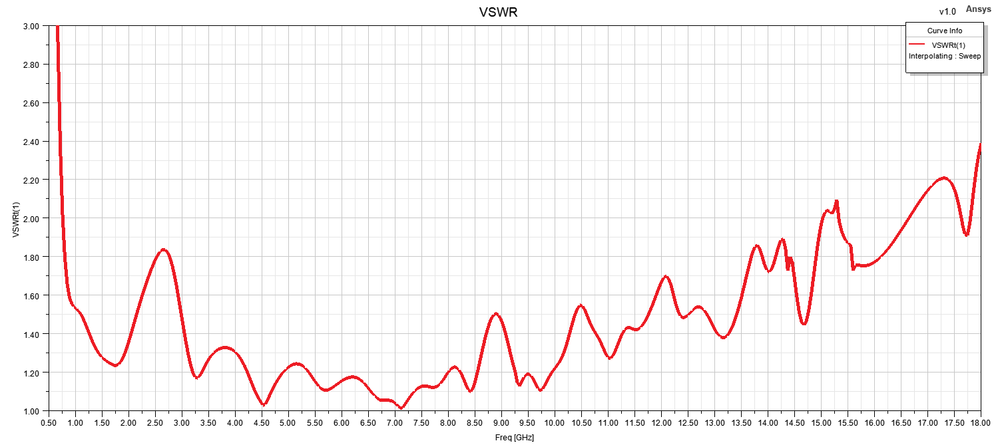

## Realized Gain

## Radiation Patterns

### 1 GHz

#### Azimuth Pattern

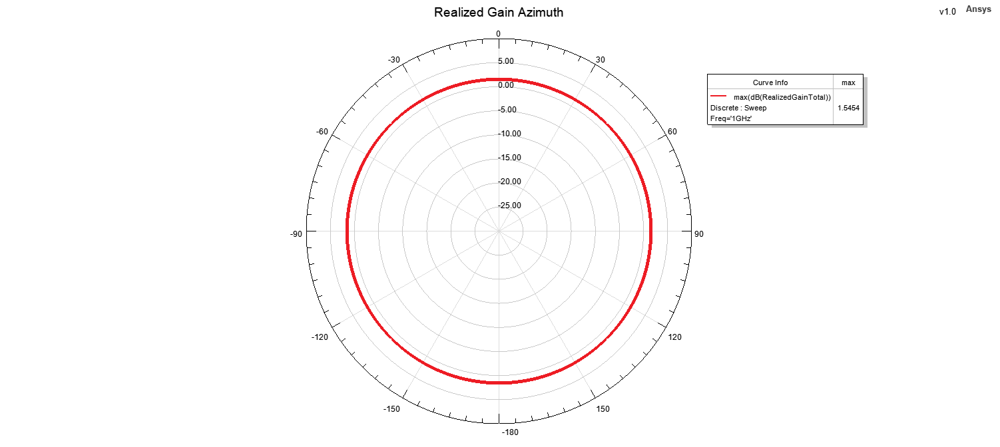

#### Elevation Pattern

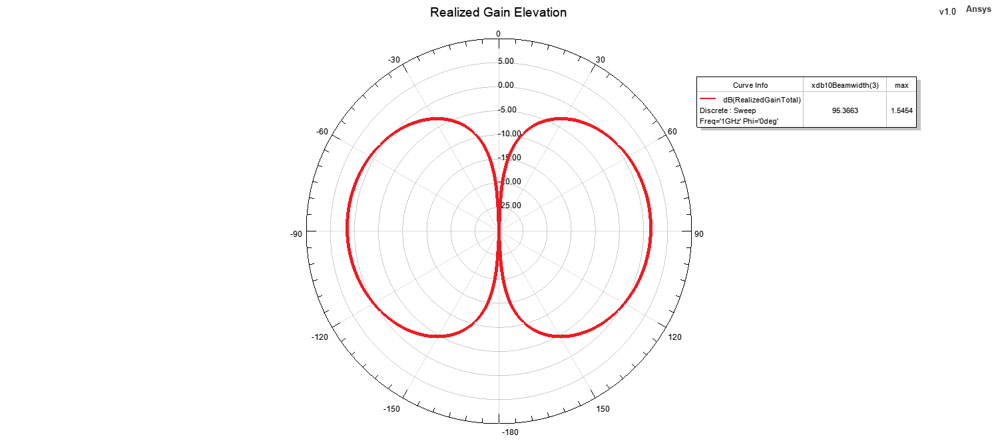

#### 3D Radiation Pattern

### 3 GHz

#### Azimuth Pattern

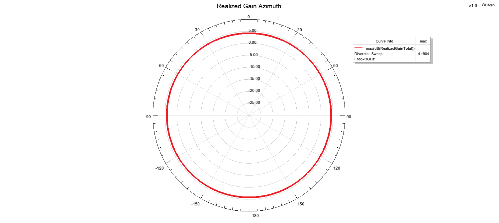

#### Elevation Pattern

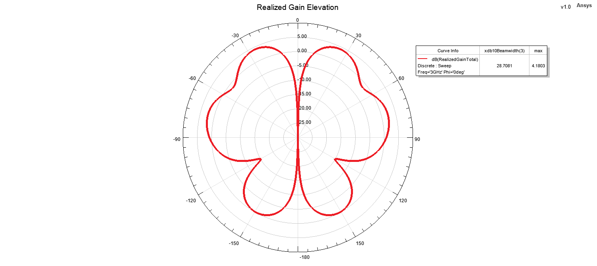

#### 3D Radiation Pattern

### 5 GHz

#### Azimuth Pattern

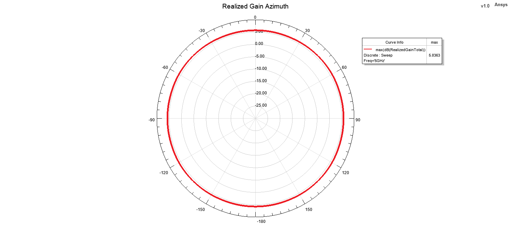

#### Elevation Pattern

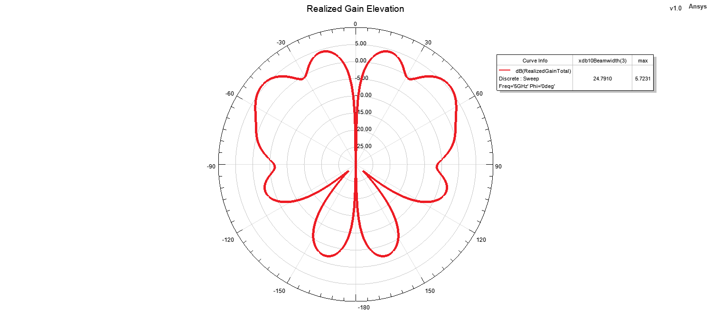

#### 3D Radiation Pattern

### 7 GHz

#### Azimuth Pattern

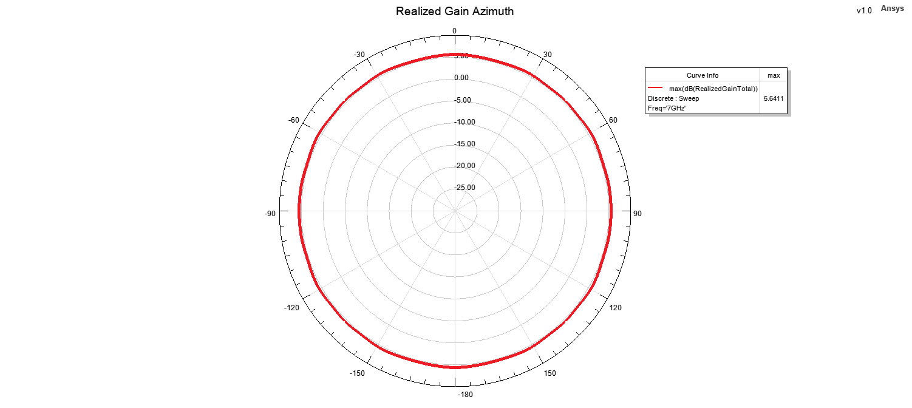

#### Elevation Pattern

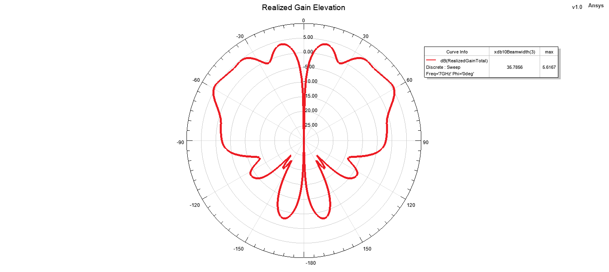

#### 3D Radiation Pattern

### 9 GHz

#### Azimuth Pattern

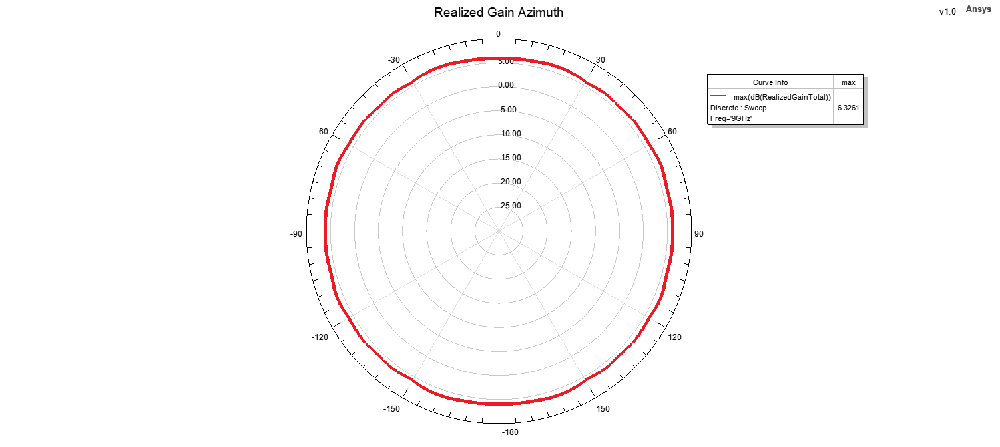

#### Elevation Pattern

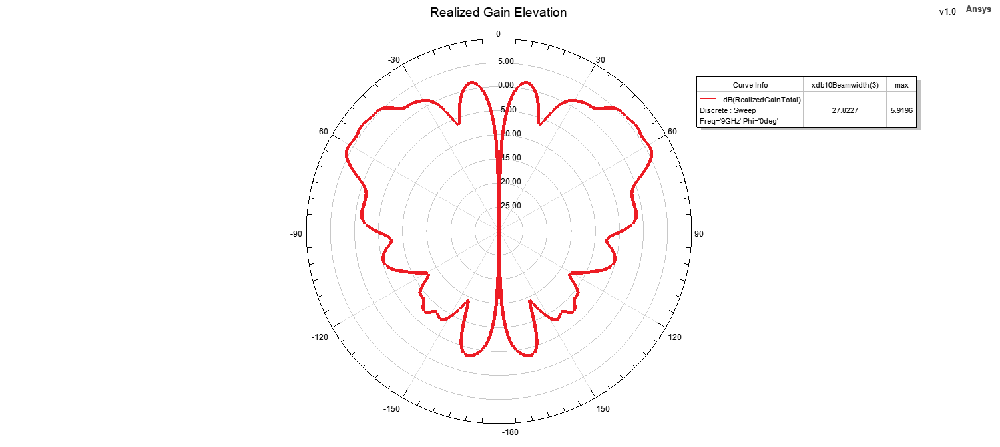

#### 3D Radiation Pattern

### 11 GHz

#### Azimuth Pattern

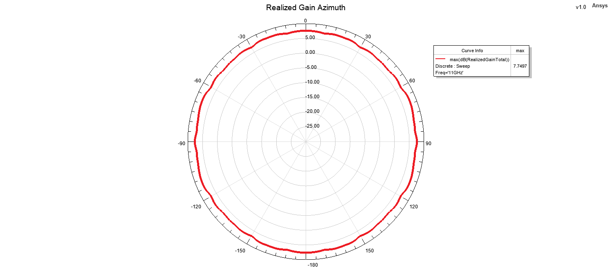

#### Elevation Pattern

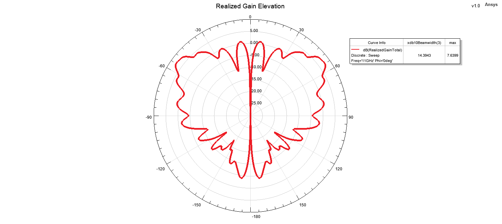

#### 3D Radiation Pattern

### 13 GHz

#### Azimuth Pattern

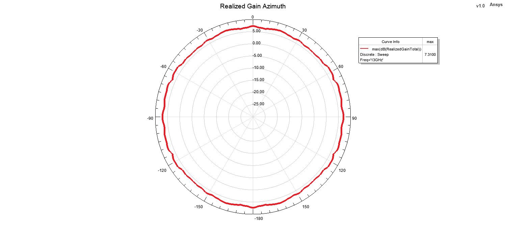

#### Elevation Pattern

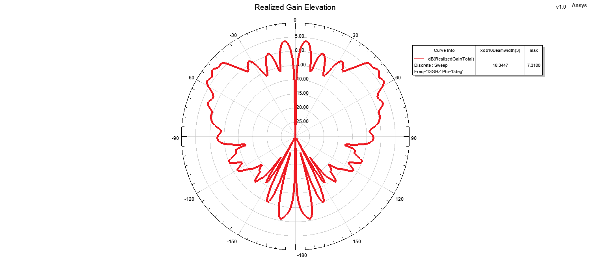

#### 3D Radiation Pattern

### 15 GHz

#### Azimuth Pattern

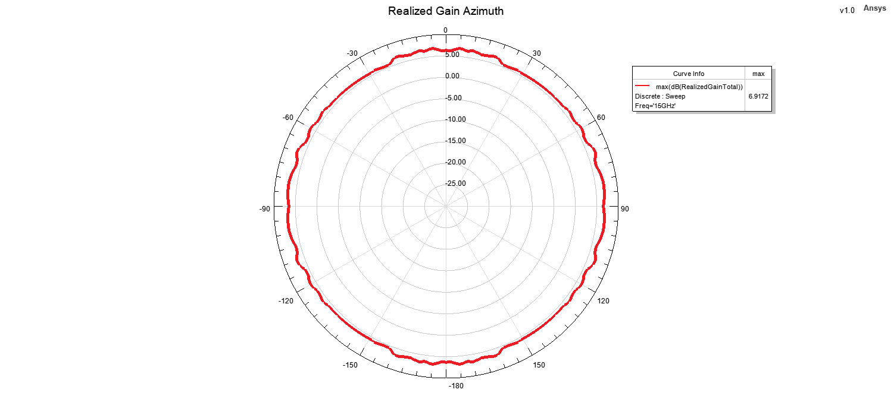

#### Elevation Pattern

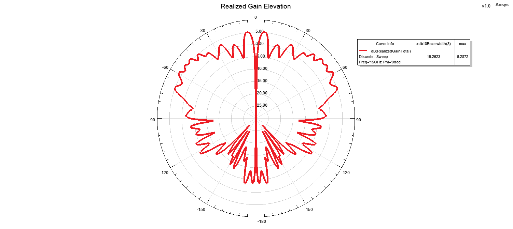

#### 3D Radiation Pattern

