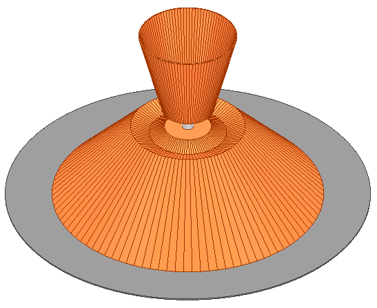
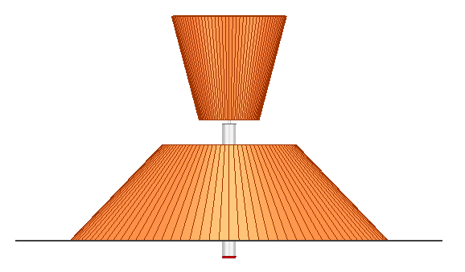
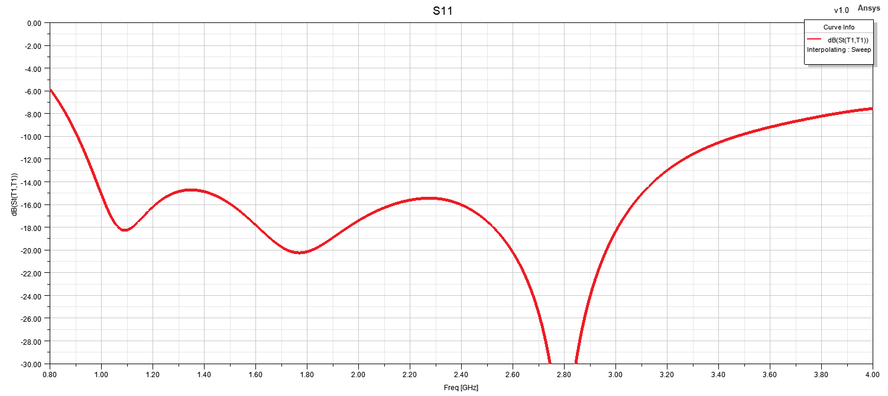
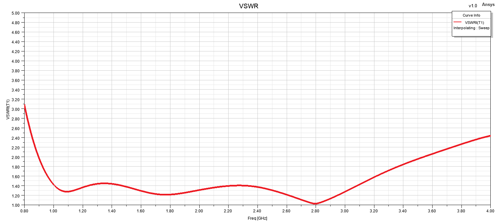
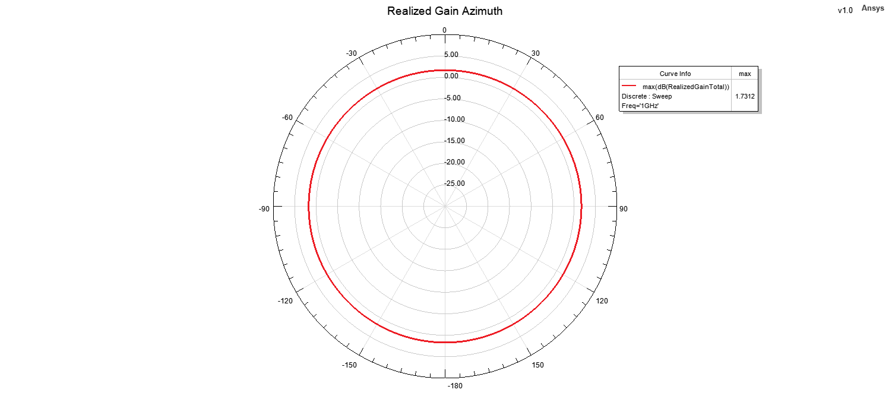
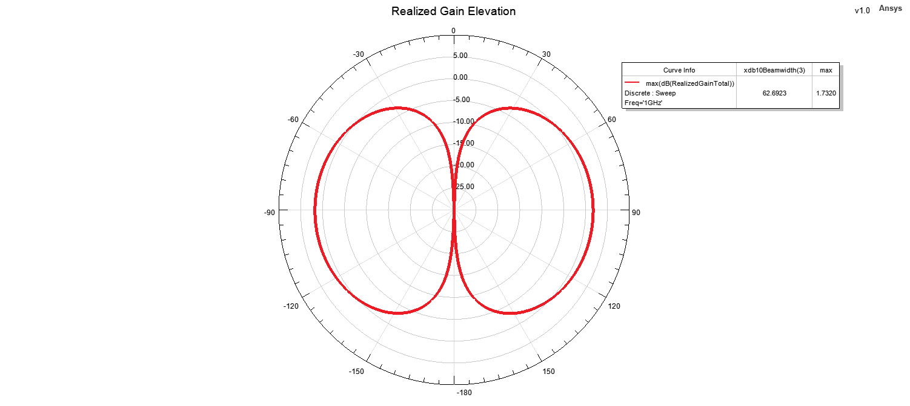
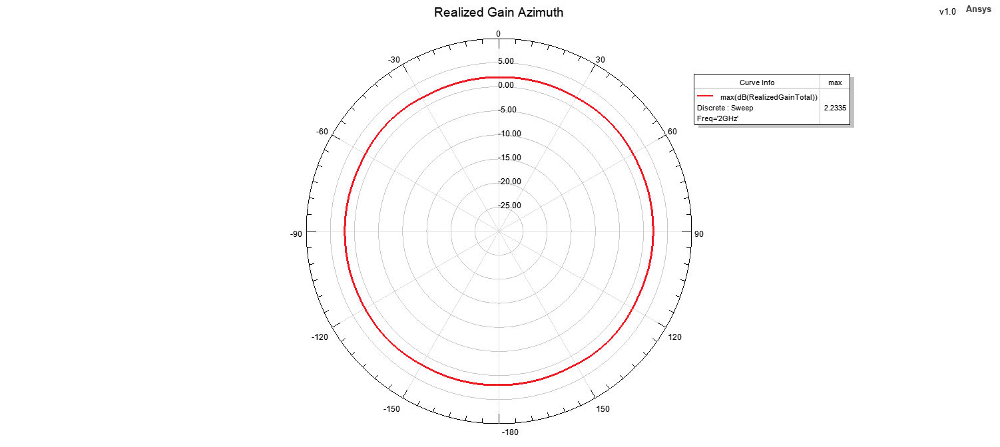
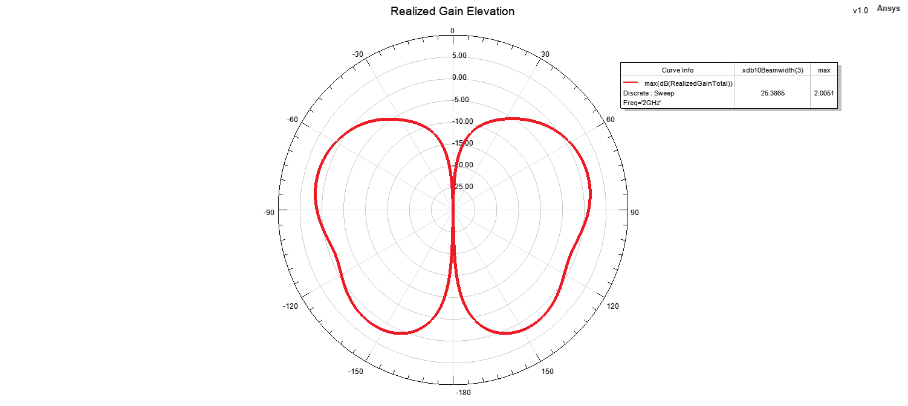
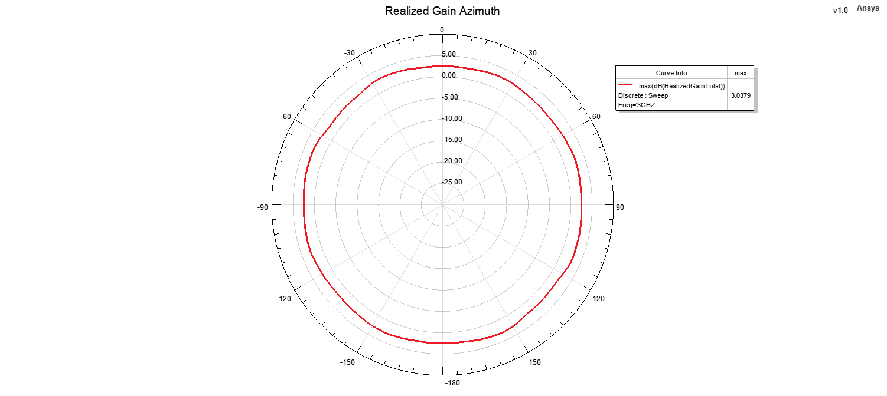
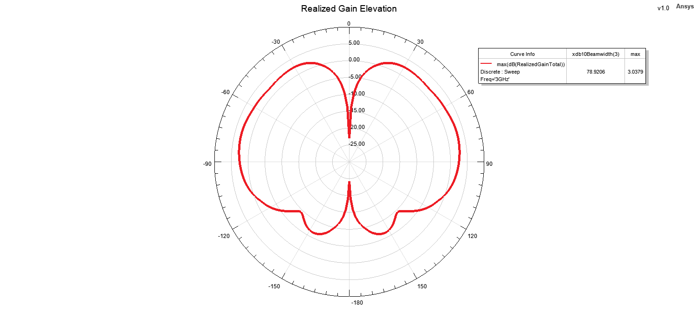

# Asymmetric Conical Antenna

## Overview

This design presents an asymmetric conical antenna developed and analyzed using ANSYS HFSS for operation from 1 GHz to 3 GHz.

Unlike a conventional rotationally symmetric conical radiator, this antenna employs an asymmetric conical geometry. The asymmetric structure is used to shape the current distribution and radiation behavior while maintaining broadband impedance characteristics across the intended operating band.

The radiating conical elements are made of copper, while the lower metallic ground/base plate is modeled using aluminum. The antenna is excited through an RG402 semi-rigid coaxial cable.

The antenna performance was evaluated using reflection coefficient, VSWR, realized gain, azimuth and elevation radiation patterns, and three-dimensional far-field radiation patterns at multiple frequencies across the operating band.

## Key Features

- **Simulation Tool:** ANSYS HFSS
- **Antenna Type:** Conical Antenna
- **Operating Frequency Range:** 1–3 GHz
- **Structure Type:** Asymmetric Conical Radiator
- **Polarization:** Linear
- **Radiation Characteristic:** Omni-directional
- **Feed Type:** Coaxial Feed
- **Coaxial Cable:** RG402 Semi-Rigid
- **Main Performance Parameters:** S11, VSWR, realized gain and radiation patterns
- **Radiation Pattern Evaluation Frequencies:** 1 GHz, 2 GHz and 3 GHz
- **Analyzed Planes:** Azimuth and Elevation

## Materials

- **Conical Radiating Elements:** Copper
- **Ground / Base Plate:** Aluminum
- **Feed Cable:** RG402 semi-rigid coaxial cable
- **Surrounding Medium:** Air / free-space simulation region
- **Simulation Environment:** ANSYS HFSS

## 3D Model

<table>
<tr>
<td align="center">
   
</td>
<td align="center">
   
</td>
</tr>
</table>

## Reflection Coefficient

## VSWR

## Realized Gain

## Radiation Patterns

### 1 GHz

#### Azimuth Pattern

#### Elevation Pattern

#### 3D Radiation Pattern

### 2 GHz

#### Azimuth Pattern

#### Elevation Pattern

#### 3D Radiation Pattern

### 3 GHz

#### Azimuth Pattern

#### Elevation Pattern

#### 3D Radiation Pattern

