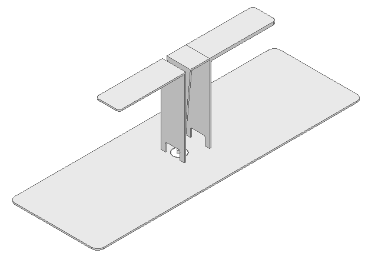
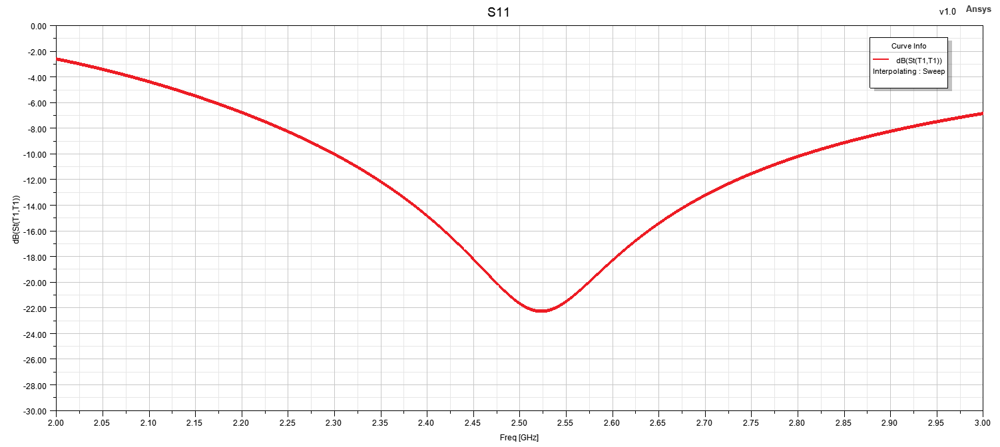
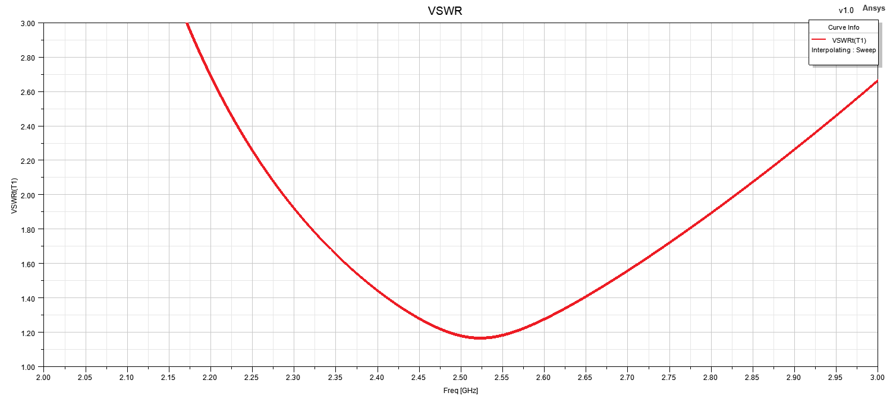
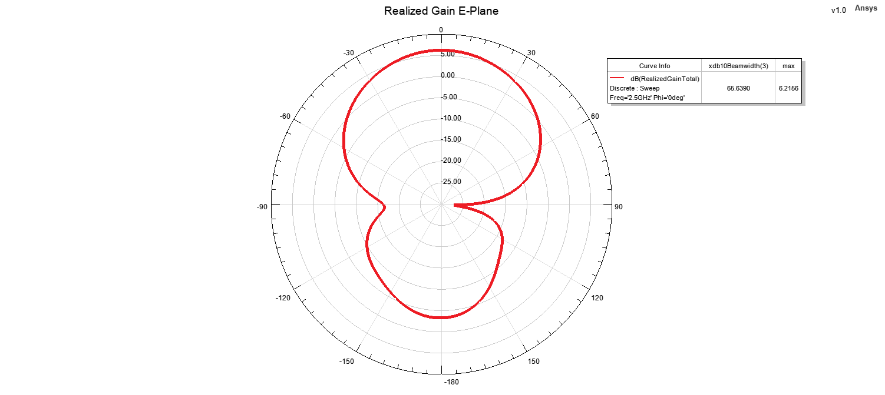
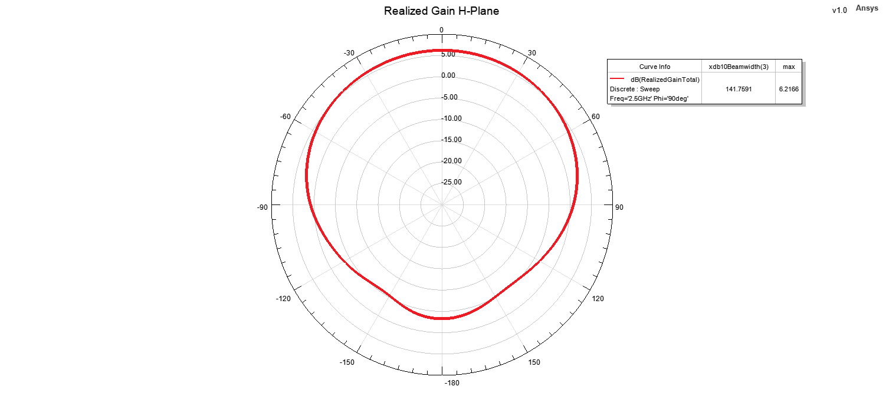

# Low-Profile Magneto-Electric Dipole Antenna

## Overview

This design presents a low-profile magneto-electric dipole antenna developed and analyzed using ANSYS HFSS for S-band operation with a center frequency of 2.5 GHz.

The antenna is a fully metallic structure composed of copper radiating elements positioned above an aluminum ground plane. The geometry combines electric- and magnetic-dipole radiation mechanisms in a compact low-profile configuration.

The design was evaluated in terms of impedance matching, VSWR, realized gain, two-dimensional principal-plane radiation patterns and three-dimensional far-field radiation characteristics.

The antenna has a ground-plane size of 30 mm × 90 mm and an overall height of 27 mm, providing a compact implementation for S-band operation.

## Key Features

- **Simulation Tool:** ANSYS HFSS
- **Antenna Type:** Low-Profile Magneto-Electric Dipole Antenna
- **Operating Band:** S-Band
- **Center Frequency:** 2.5 GHz
- **Structure Type:** Fully Metallic
- **Polarization:** Linear
- **Ground Plane Dimensions:** 30 mm × 90 mm
- **Overall Antenna Height:** 27 mm
- **Main Performance Parameters:** S11, VSWR, realized gain and radiation patterns
- **Radiation Pattern Evaluation Frequency:** 2.5 GHz
- **Analyzed Planes:** E-Plane and H-Plane

## Materials

- **Radiating Elements:** Copper plates
- **Ground Plane:** Aluminum
- **Surrounding Medium:** Air / free-space simulation region
- **Simulation Environment:** ANSYS HFSS

## 3D Model

<table>
<tr>
<td align="center">
   
</td>
<td align="center">
   
</td>
</tr>
</table>

## Reflection Coefficient

## VSWR

## Realized Gain

## Radiation Patterns at 2.5 GHz

### E-Plane

### H-Plane

## 3D Realized Gain Pattern

