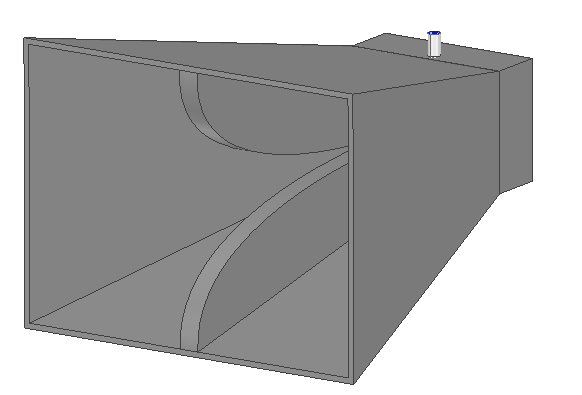

# 2–18 GHz Double-Ridged Horn Antenna

## Overview
Wideband double-ridged horn antenna designed and analyzed using ANSYS HFSS.

**Frequency Range:** 2–18 GHz
**Simulation Tool:** ANSYS HFSS
**Antenna Type:** Double-Ridged Horn

## 3D Model

