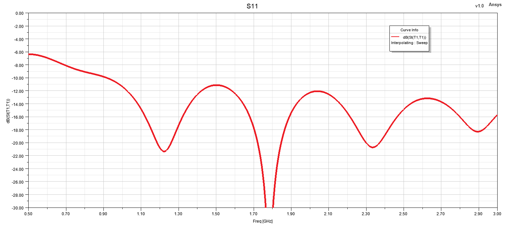
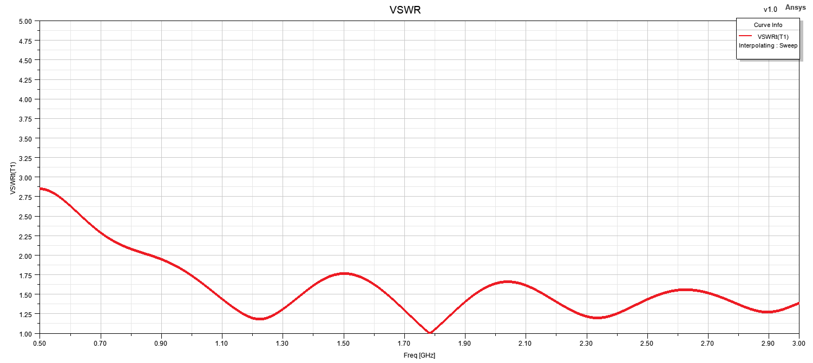
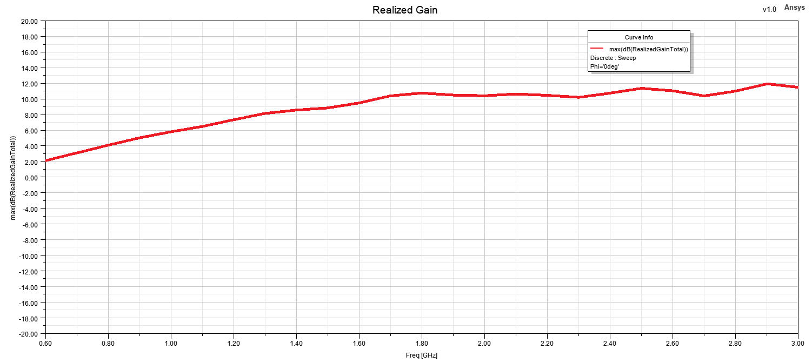
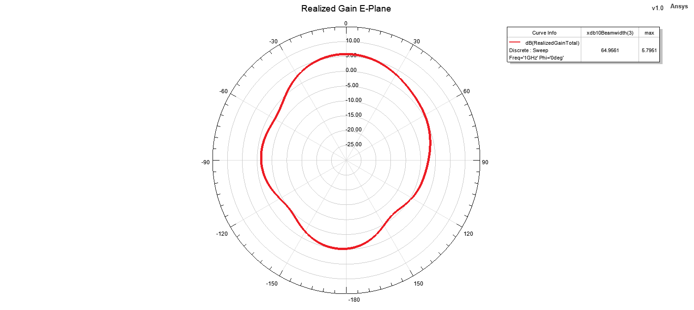
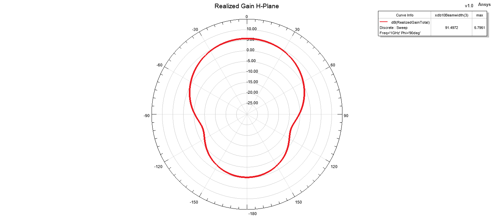
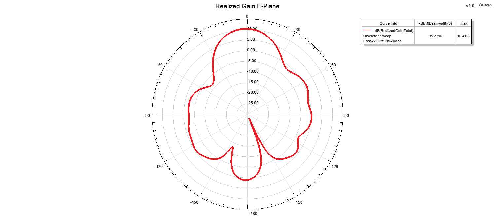
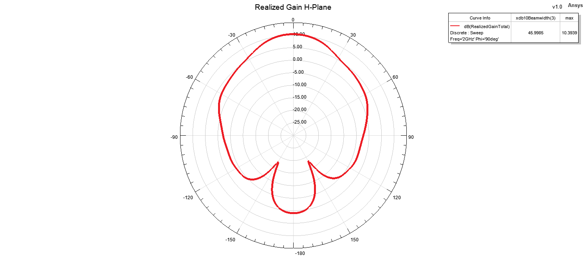
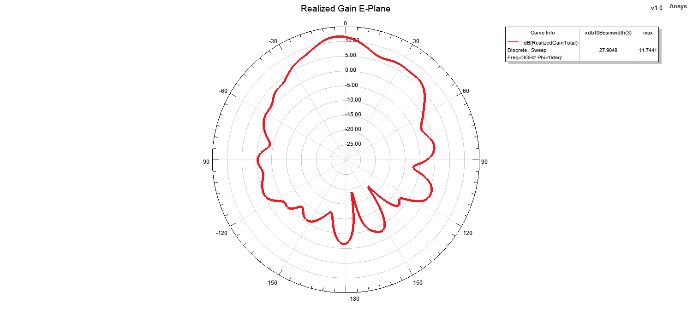
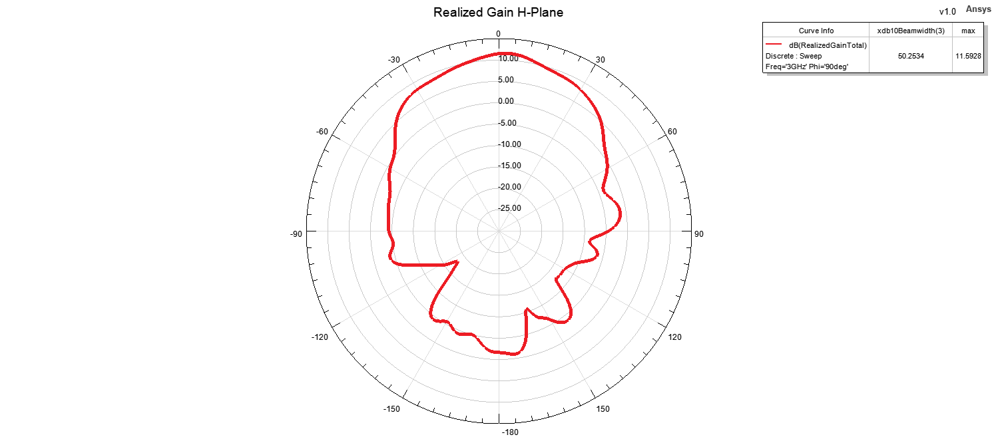

# TEM Horn Antenna

## Overview

This design presents a TEM horn antenna developed and analyzed using ANSYS HFSS for operation from 1 GHz to 3 GHz.

The antenna consists of two exponentially flared metallic arms forming the radiating structure. Both arms are made of copper and are shaped to support broadband operation and stable radiation performance across the intended frequency range.

A compact balun structure is integrated at the feeding region of the antenna in order to provide a proper transition from the coaxial feed to the balanced horn structure. The antenna is excited using a coaxial feed.

The antenna exhibits unidirectional radiation characteristics and provides relatively high and stable realized gain throughout its operating band.

The antenna performance was evaluated using reflection coefficient, VSWR, realized gain, principal-plane radiation patterns and three-dimensional far-field radiation patterns at multiple frequencies within the operating band.

## Key Features

- **Simulation Tool:** ANSYS HFSS
- **Antenna Type:** TEM Horn Antenna
- **Operating Frequency Range:** 1–3 GHz
- **Radiation Characteristic:** Uni-directional
- **Polarization:** Linear
- **Radiating Structure:** Two exponentially flared arms
- **Feed Type:** Coaxial Feed
- **Feeding Transition:** Compact balun structure
- **Main Performance Parameters:** S11, VSWR, realized gain and radiation patterns
- **Radiation Pattern Evaluation Frequencies:** 1 GHz, 2 GHz and 3 GHz
- **Analyzed Planes:** E-Plane and H-Plane

## Materials

- **Radiating Arms:** Copper
- **Surrounding Medium:** Air / free-space simulation region
- **Simulation Environment:** ANSYS HFSS

## 3D Model

<table>
<tr>
<td align="center">
  
</td>
<td align="center">
  
</td>
</tr>
</table>

## Reflection Coefficient

## VSWR

## Realized Gain

## Radiation Patterns

### 1 GHz

#### E-Plane

#### H-Plane

#### 3D Radiation Pattern

### 2 GHz

#### E-Plane

#### H-Plane

#### 3D Radiation Pattern

### 3 GHz

#### E-Plane

#### H-Plane

#### 3D Radiation Pattern

