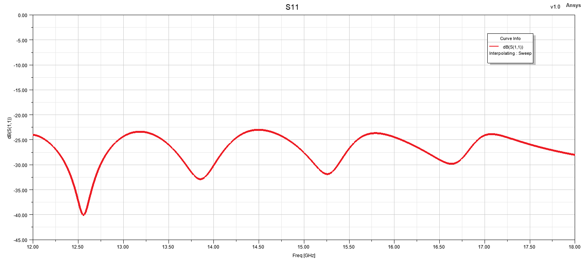
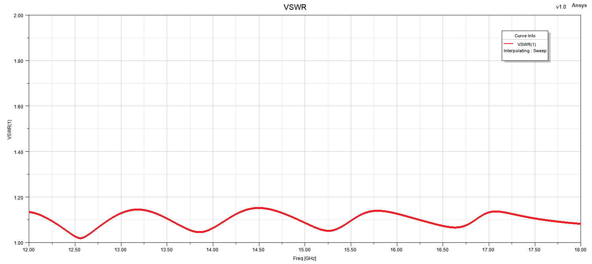
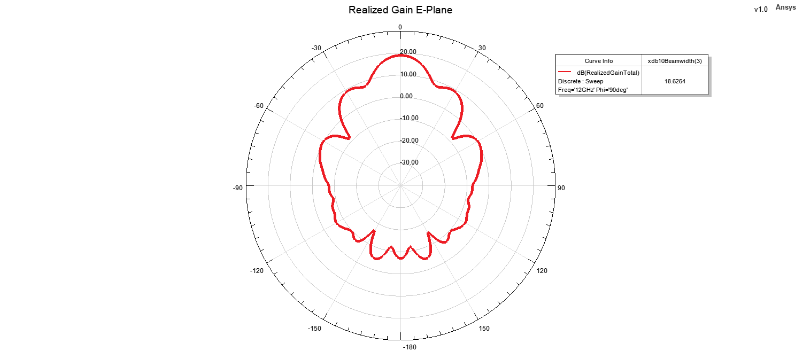
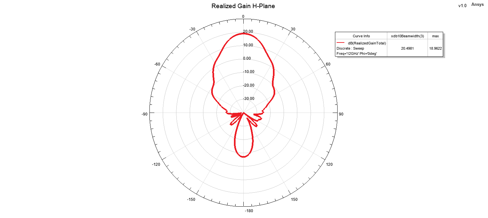
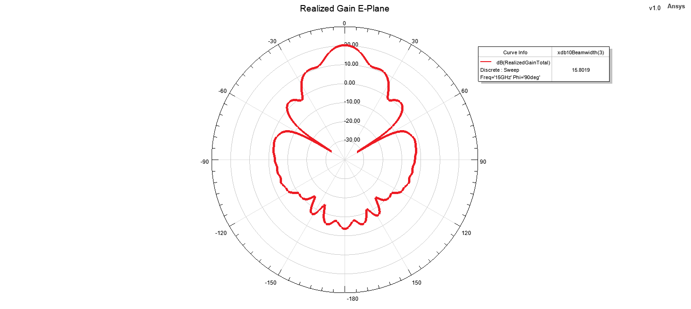
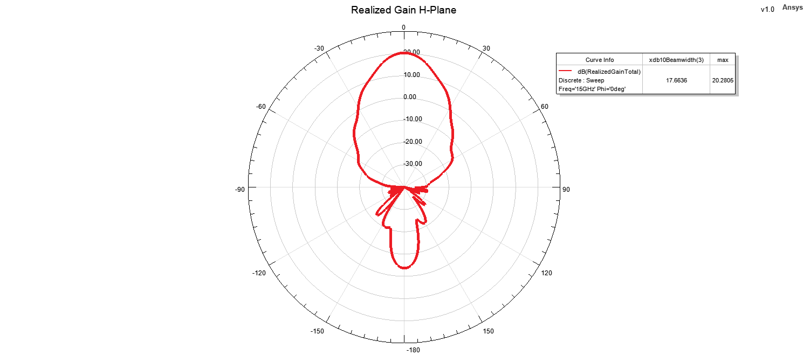
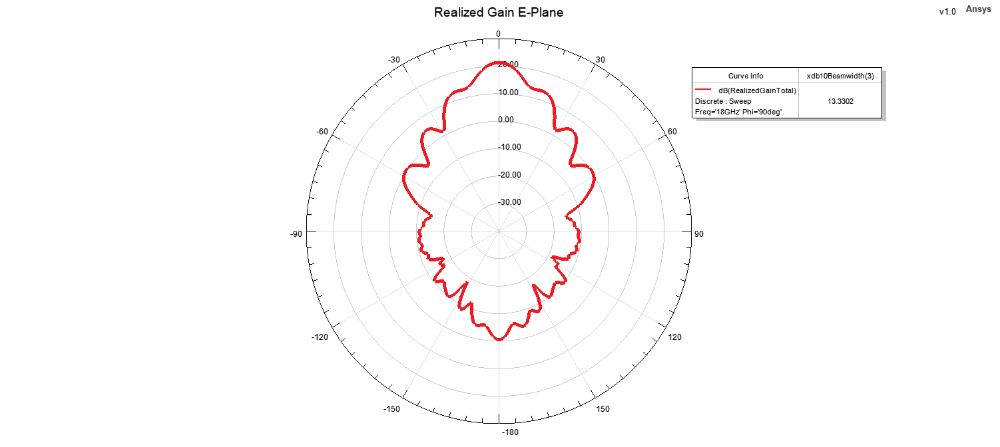
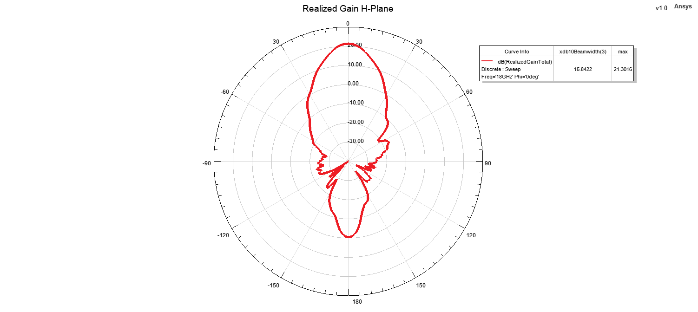

# Ku-Band Pyramidal Horn Antenna

## Overview

This design presents a Ku-band pyramidal horn antenna developed and analyzed using ANSYS HFSS.

The antenna dimensions were initially calculated using MATLAB based on classical horn antenna design equations, with a target realized gain of approximately 20 dBi at the 15 GHz center frequency. The calculated dimensions were then transferred to the electromagnetic simulation environment for full-wave analysis and performance verification.

The antenna is excited through a WR62 rectangular waveguide feed. The waveguide section provides the fundamental TE10 mode required to excite the horn aperture.

The antenna performance was evaluated using reflection coefficient, VSWR, realized gain, front-to-back ratio, E-plane and H-plane radiation patterns, and three-dimensional far-field radiation patterns at representative frequencies across the operating band.

## Key Features

- **Simulation Tool:** ANSYS HFSS
- **Initial Design / Dimension Calculation:** MATLAB
- **Antenna Type:** Pyramidal Horn Antenna
- **Operating Band:** Ku-Band
- **Center Frequency:** 15 GHz
- **Target Gain at Center Frequency:** 20 dBi
- **Feed Type:** Rectangular Waveguide
- **Waveguide Standard:** WR62
- **Radiation Characteristic:** Uni-directional
- **Polarization:** Linear
- **Main Performance Parameters:** S11, VSWR, realized gain, front-to-back ratio and radiation patterns
- **Radiation Pattern Evaluation Frequencies:** 12 GHz, 15 GHz and 18 GHz
- **Analyzed Planes:** E-Plane and H-Plane

## Materials

- **Horn Structure:** Metallic conducting structure
- **Feed Structure:** WR62 rectangular waveguide
- **Surrounding Medium:** Air / free-space simulation region
- **Simulation Environment:** ANSYS HFSS

## 3D Model

## Reflection Coefficient

## VSWR

## Realized Gain

## Front-to-Back Ratio

## Radiation Patterns

### 12 GHz

#### E-Plane

#### H-Plane

#### 3D Radiation Pattern

### 15 GHz

#### E-Plane

#### H-Plane

#### 3D Radiation Pattern

### 18 GHz

#### E-Plane

#### H-Plane

#### 3D Radiation Pattern

