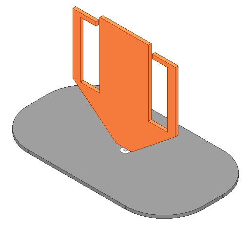
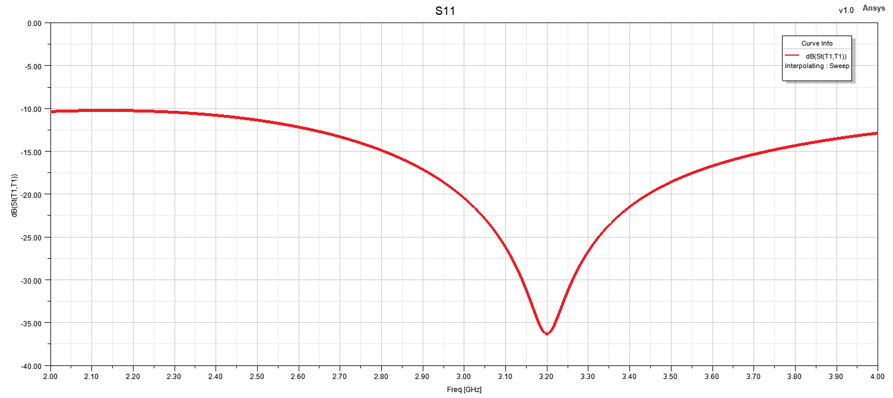
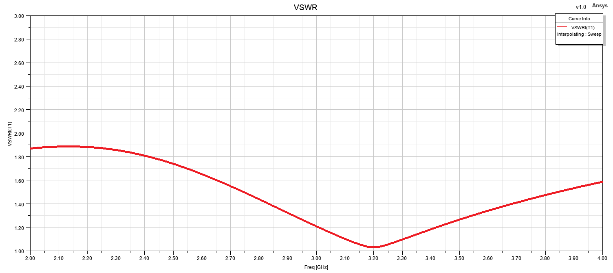
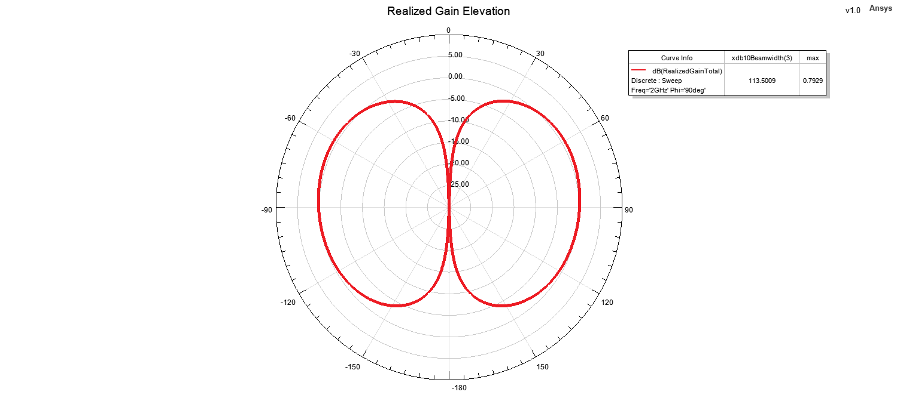
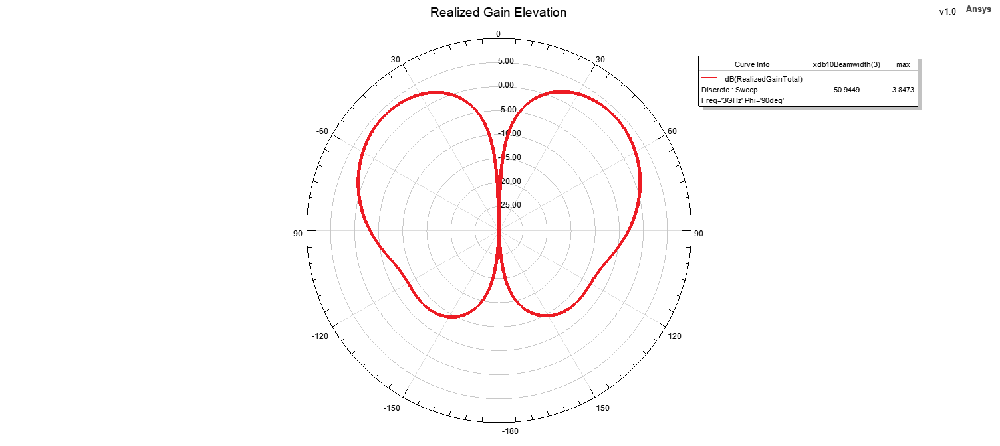
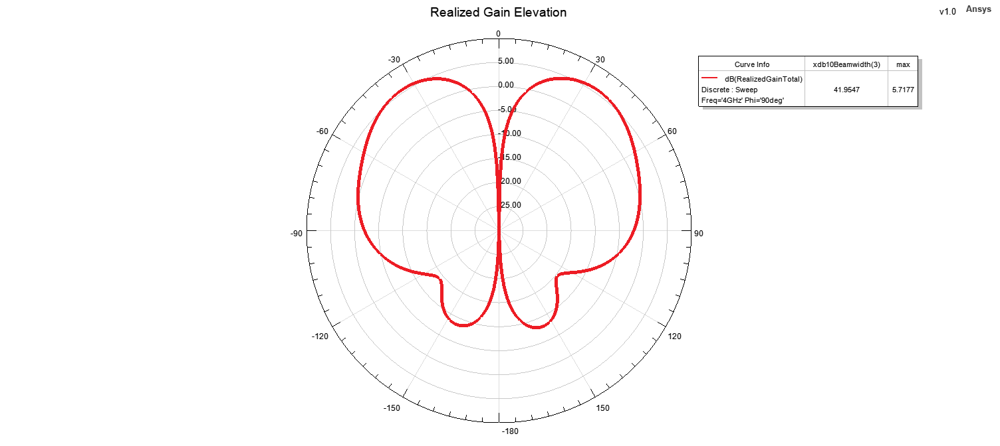

# Blade Antenna - Design 1

## Overview

This design presents a broadband blade antenna developed and analyzed using ANSYS HFSS.

The antenna was designed as a compact monopole-type radiator with a blade-shaped conductive geometry, intended to provide wideband impedance behavior and stable radiation characteristics over the operating frequency range.

The design was evaluated in terms of input matching, VSWR, realized gain and far-field radiation characteristics at multiple frequencies.

## Key Features

- **Simulation Tool:** ANSYS HFSS
- **Antenna Type:** Blade / Monopole Antenna
- **Operating Frequency Range:** Approximately 2–4 GHz
- **Polarization:** Linear
- **Radiation Characteristic:** Omni-directional
- **Main Performance Parameters:** S11, VSWR, realized gain and radiation patterns
- **Radiation Pattern Evaluation Frequencies:** 2 GHz, 3 GHz and 4 GHz

## Design Description

The antenna consists of a vertically oriented blade-shaped radiating element positioned above a conductive ground structure.

The blade geometry provides a larger effective radiating surface compared with a conventional thin-wire monopole and can support broadband operation by distributing the surface current over a wider region of the radiator.

The antenna geometry and feeding configuration were modeled in ANSYS HFSS. The electromagnetic performance was analyzed by evaluating the reflection coefficient, VSWR, realized gain and elevation-plane radiation patterns over the operating frequency range.

Radiation patterns were examined at 2 GHz, 3 GHz and 4 GHz in order to evaluate the stability of the antenna radiation characteristics across the band.

## Materials

- **Radiating Element:** Conductive metallic structure
- **Ground Structure:** Conductive ground plane
- **Surrounding Medium:** Air / free-space simulation region
- **Simulation Environment:** ANSYS HFSS

> Note: Exact mechanical dimensions, material properties and detailed design parameters are intentionally omitted from the public portfolio.

## 3D Model

## Reflection Coefficient

## VSWR

## Realized Gain

## Radiation Patterns

### 2 GHz Elevation Pattern

### 3 GHz Elevation Pattern

### 4 GHz Elevation Pattern

