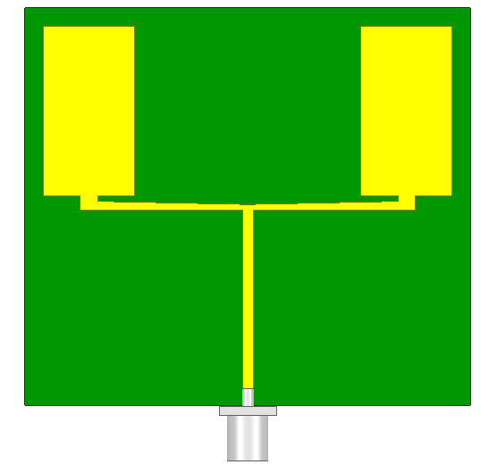
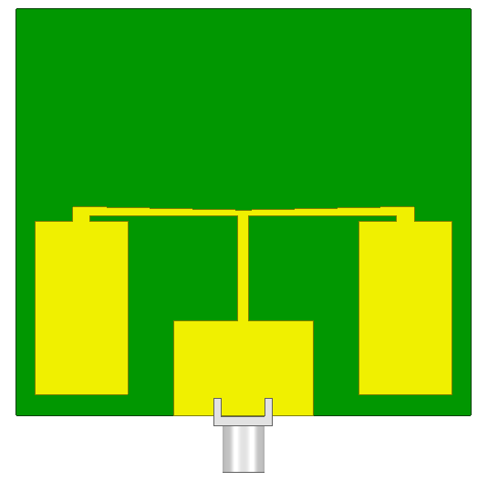
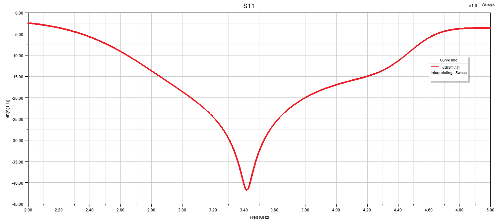
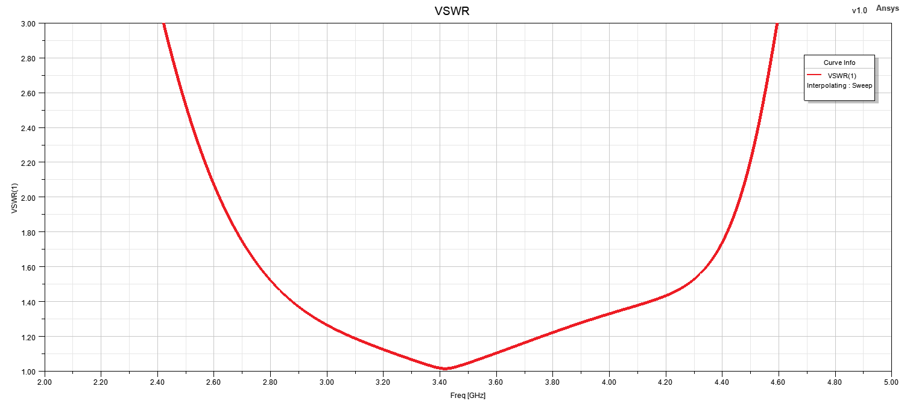
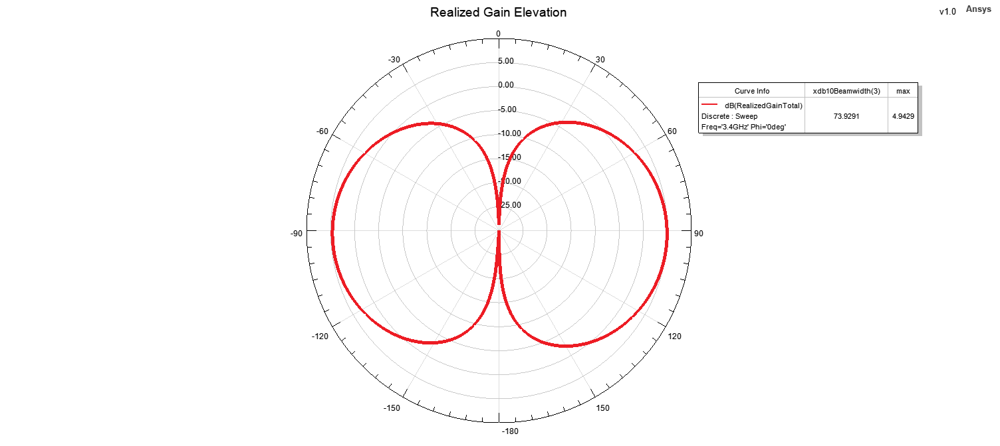
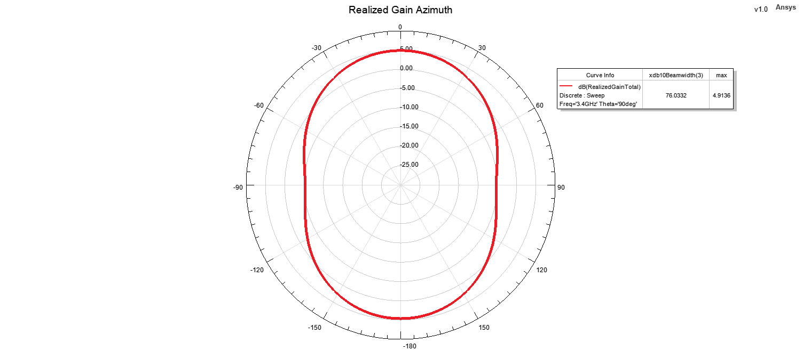

# Monopole Antenna - Design 2

## 3D Model

  
  

## Reflection Coefficient

## VSWR

## Realized Gain

## Radiation Patterns at 3.4 GHz

### Elevation Pattern

### Azimuth Pattern

## 3D Radiation Pattern at 3.4 GHz

