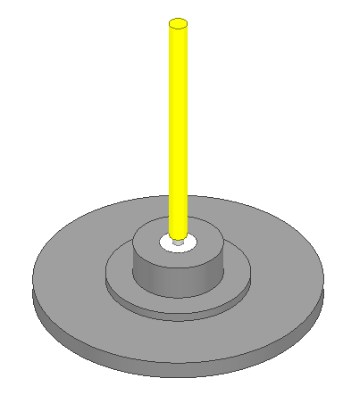
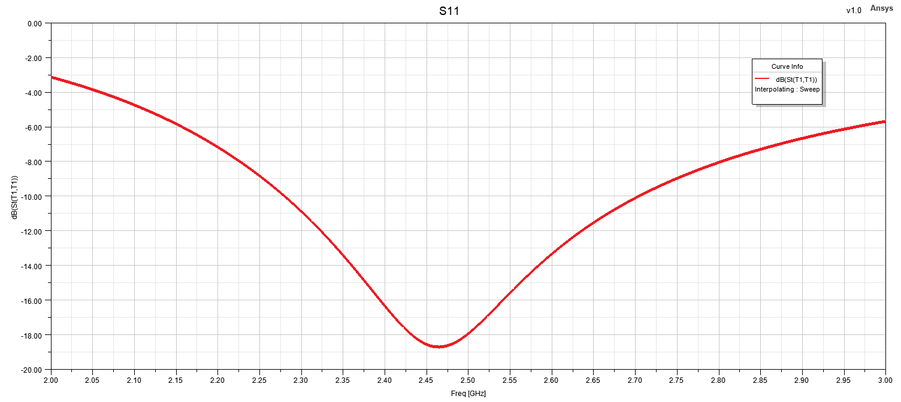
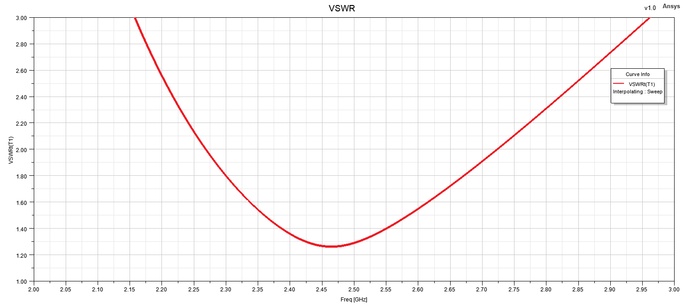
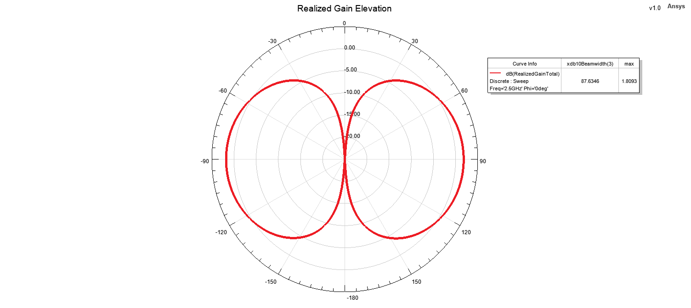
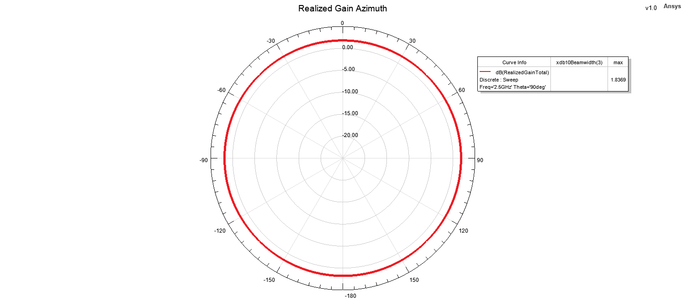

# Monopole Antenna - Design 3

## Overview

This design presents a compact monopole antenna developed and analyzed using ANSYS HFSS.

The antenna employs a planar conductive radiating element above a ground structure and was designed to provide suitable impedance matching and stable radiation performance around the target operating frequency.

The electromagnetic performance of the antenna was evaluated through reflection coefficient, VSWR, realized gain, two-dimensional radiation patterns and three-dimensional far-field radiation characteristics.

## Key Features

- **Simulation Tool:** ANSYS HFSS
- **Antenna Type:** Planar Monopole Antenna
- **Target Frequency:** 2.5 GHz
- **Polarization:** Linear
- **Radiation Characteristic:** Broad monopole-type radiation coverage
- **Main Performance Parameters:** S11, VSWR, realized gain and radiation patterns
- **Radiation Pattern Evaluation Frequency:** 2.5 GHz
- **Analyzed Planes:** Elevation and Azimuth

## Design Description

The antenna consists of a planar conductive radiator positioned above a conductive ground structure.

The geometry of the radiating element determines the effective current path and therefore influences both the impedance response and the radiation characteristics of the antenna.

The model was developed in ANSYS HFSS and evaluated around the target operating frequency. The design performance was analyzed using input matching, VSWR and realized gain results.

Far-field characteristics were evaluated at 2.5 GHz using both elevation- and azimuth-plane radiation patterns. A three-dimensional far-field radiation pattern was also generated in order to visualize the overall radiation behavior of the antenna.

## Materials

- **Radiating Element:** Conductive metallic structure
- **Ground Structure:** Conductive ground plane
- **Surrounding Medium:** Air / free-space simulation region
- **Simulation Environment:** ANSYS HFSS

> Note: Exact mechanical dimensions, material properties and detailed design parameters are intentionally omitted from the public portfolio.

## 3D Model

## Reflection Coefficient

## VSWR

## Realized Gain

## Radiation Patterns at 2.5 GHz

  
  

  <b>Elevation Pattern</b> &nbsp;&nbsp;&nbsp;&nbsp;&nbsp;&nbsp;&nbsp;&nbsp;
  <b>Azimuth Pattern</b>

## 3D Radiation Pattern at 2.5 GHz

