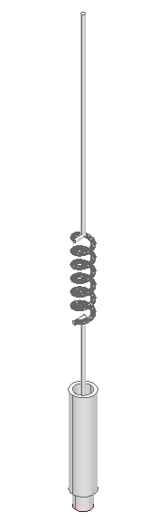
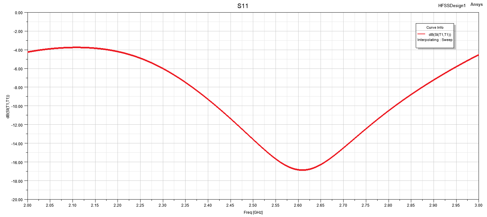
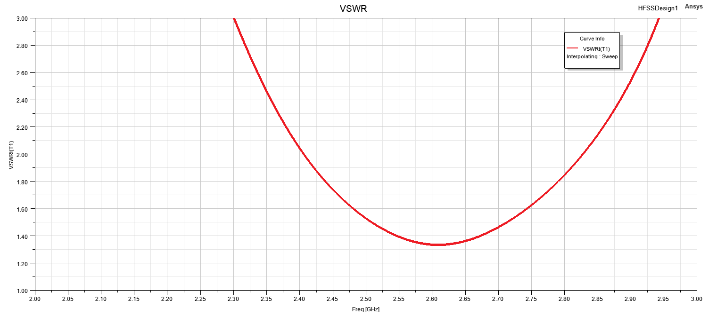
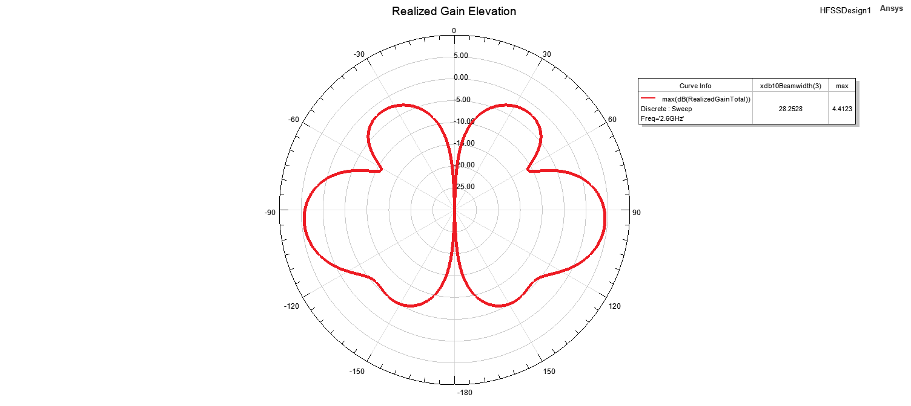
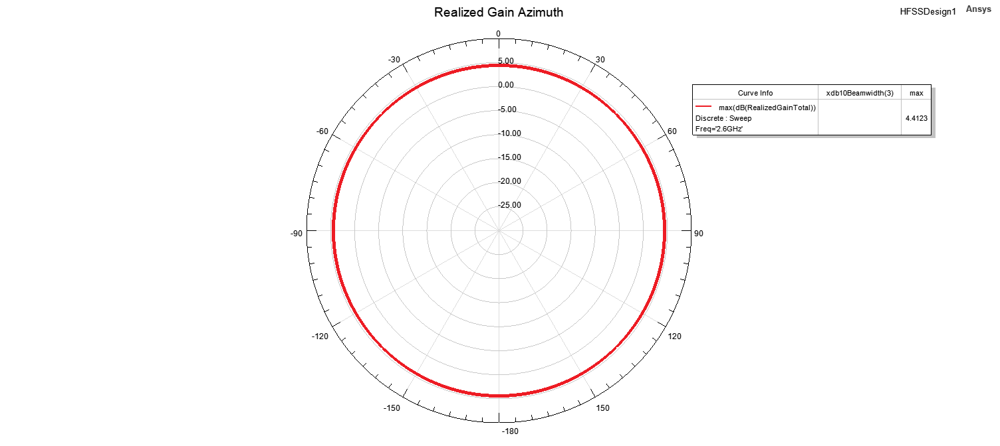

# S Band Whip Antenna

## Overview

This design presents a compact whip antenna developed and analyzed using ANSYS HFSS.

The antenna employs a planar conductive radiating structure above a conductive ground plane and was designed to provide suitable impedance matching and monopole-type radiation characteristics around the target operating frequency.

The electromagnetic performance of the antenna was evaluated through reflection coefficient, VSWR, two-dimensional radiation patterns and three-dimensional far-field radiation characteristics.

## Key Features

- **Simulation Tool:** ANSYS HFSS
- **Antenna Type:** Whip Antenna
- **Target Frequency:** 2.6 GHz
- **Polarization:** Linear
- **Radiation Characteristic:** Omni-directional
- **Main Performance Parameters:** S11, VSWR and radiation patterns
- **Radiation Pattern Evaluation Frequency:** 2.6 GHz
- **Analyzed Planes:** Elevation and Azimuth

## Materials

- **Radiating Element:** Copper
- **Ground Structure:** Aluminum
- **Surrounding Medium:** Air / free-space simulation region
- **Simulation Environment:** ANSYS HFSS

## 3D Model

## Reflection Coefficient

## VSWR

## Radiation Patterns at 2.6 GHz

  
  

  <b>Elevation Pattern</b> &nbsp;&nbsp;&nbsp;&nbsp;&nbsp;&nbsp;&nbsp;&nbsp;
  <b>Azimuth Pattern</b>

## 3D Radiation Pattern at 2.6 GHz

