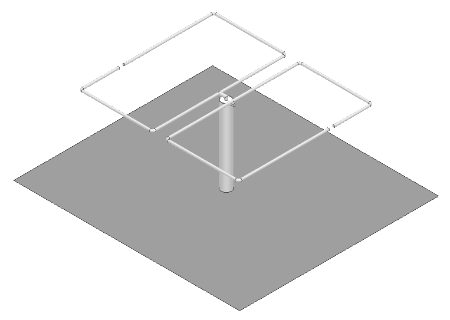
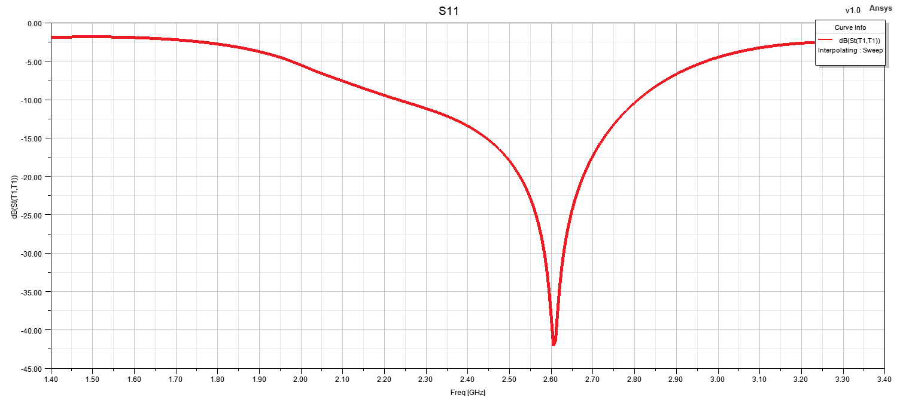
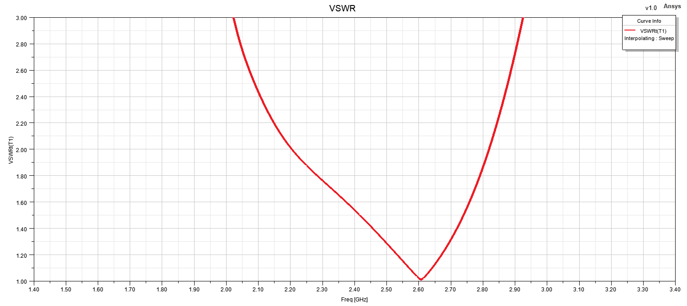

# RHCP Bi-Quad Antenna

## Overview

This design presents a quad antenna developed and analyzed using ANSYS HFSS for right-hand circular polarization (RHCP) operation.

Circular polarization is achieved through two intentional cuts introduced into the radiating structure. These perturbations modify the current distribution on the antenna and excite two orthogonal field components with the required phase relationship for RHCP operation.

The antenna performance was evaluated using VSWR, principal-plane radiation patterns and three-dimensional realized gain results.

## Key Features

- **Simulation Tool:** ANSYS HFSS
- **Antenna Type:** Quad Antenna
- **Polarization:** Right-Hand Circular Polarization (RHCP)
- **Target Frequency:** 2.6 GHz
- **Main Performance Parameters:** S11, VSWR, E-plane pattern, H-plane pattern and RHCP realized gain
- **Radiation Pattern Evaluation Frequency:** 2.6 GHz

## Materials and Feeding

- **Radiating Element:** Copper
- **Ground Plane:** Aluminum
- **Feed Cable:** RG402 semi-rigid coaxial cable
- **Surrounding Medium:** Air / free-space simulation region

## 3D Model

## Reflection Coefficient

## VSWR

## Radiation Patterns at 2.6 GHz

  
  

  <b>E-Plane</b> &nbsp;&nbsp;&nbsp;&nbsp;&nbsp;&nbsp;&nbsp;&nbsp;
  <b>H-Plane</b>

## RHCP Realized Gain

