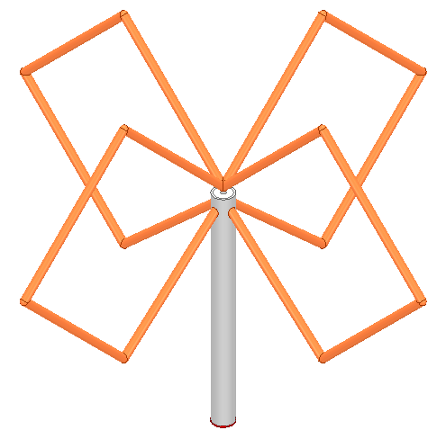
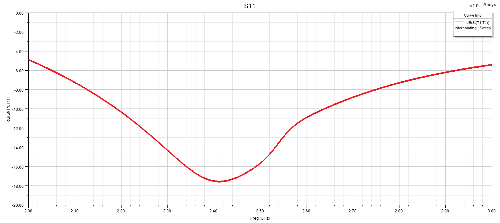
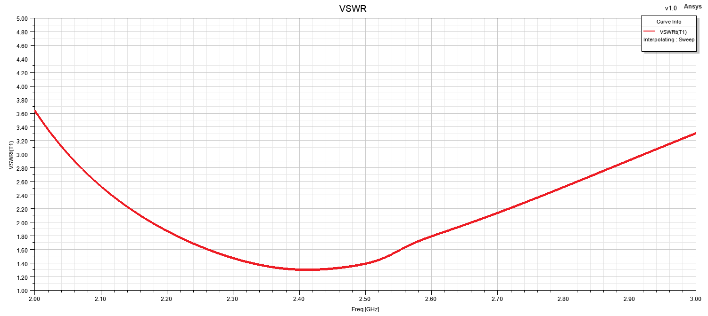
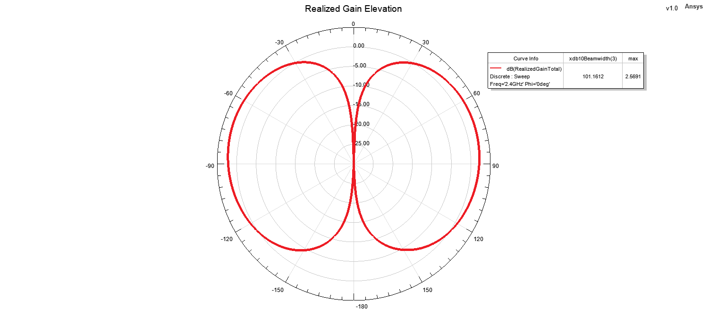
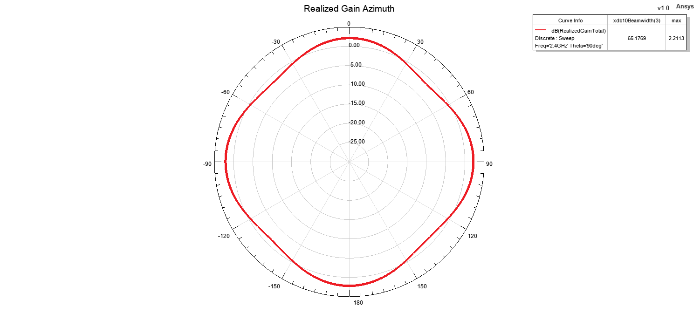

# Dual Bi-Quad Antenna

## Overview

This design presents a dual bi-quad antenna developed and analyzed using ANSYS HFSS for omnidirectional radiation characteristics around 2.4 GHz.

The antenna consists of two bi-quad radiating structures arranged symmetrically around the feed region. This configuration is intended to improve azimuthal coverage and provide a more uniform radiation pattern compared with a single directional bi-quad element.

The radiating structure is formed using copper wire and is excited through an RG402 semi-rigid coaxial cable. The antenna performance was evaluated using reflection coefficient, VSWR, realized gain, elevation and azimuth radiation patterns, and a three-dimensional realized gain pattern.

## Key Features

- **Simulation Tool:** ANSYS HFSS
- **Antenna Type:** Dual Bi-Quad Antenna
- **Target Frequency:** 2.4 GHz
- **Polarization:** Linear
- **Radiation Characteristic:** Omnidirectional
- **Feed Type:** Coaxial Feed
- **Coaxial Cable:** RG402 Semi-Rigid
- **Radiating Element:** Copper Wire
- **Main Performance Parameters:** S11, VSWR, realized gain and radiation patterns
- **Radiation Pattern Evaluation Frequency:** 2.4 GHz
- **Analyzed Planes:** Elevation and Azimuth

## Materials

- **Radiating Element:** Copper wire
- **Feed Cable:** RG402 semi-rigid coaxial cable
- **Feed Type:** Coaxial excitation
- **Surrounding Medium:** Air / free-space simulation region
- **Simulation Environment:** ANSYS HFSS

## 3D Model

## Reflection Coefficient

## VSWR

## Realized Gain

## Radiation Patterns at 2.4 GHz

### Elevation Pattern

### Azimuth Pattern

## 3D Realized Gain Pattern

