# 0.8–6 GHz Cavity-Backed Spiral Antenna

## Overview

This design presents a wideband cavity-backed spiral antenna developed and analyzed using ANSYS HFSS for operation from 0.8 GHz to 6 GHz.

The antenna employs an exponentially tapered balun to support broadband impedance transformation and feeding. The spiral antenna and balun are implemented on an FR-4 substrate with a different thickness.

A conventional spiral antenna generally exhibits bi-directional radiation characteristics. In this design, a cavity-backed configuration is used in order to obtain a unidirectional radiation pattern. Eccosorb AN77 absorber material is placed inside the cavity to reduce unwanted internal reflections.

The antenna performance was evaluated using reflection coefficient, VSWR, realized gain, axial ratio versus frequency and cross-polar discrimination (XPD). In addition, E-plane, H-plane, axial-ratio radiation patterns and 3D realized gain patterns were examined at multiple frequencies across the operating band.

## Key Features

- **Simulation Tool:** ANSYS HFSS
- **Antenna Type:** Cavity-Backed Spiral Antenna
- **Operating Frequency Range:** 0.8–6 GHz
- **Polarization:** Circular Polarization
- **Radiation Characteristic:** Uni-directional
- **Feeding Structure:** Exponentially Tapered Balun
- **Main Performance Parameters:** S11, VSWR, realized gain, axial ratio and XPD
- **Radiation Pattern Evaluation Frequencies:** 1, 2, 3, 4, 5 and 6 GHz
- **Analyzed Planes:** E-Plane and H-Plane

## Materials

- **Spiral Antenna Substrate:** FR-4
- **Balun Substrate:** FR-4
- **Absorber Material:** Eccosorb AN77
- **Surrounding Medium:** Air / free-space simulation region
- **Simulation Environment:** ANSYS HFSS

## Exponentially Tapered Balun Geometry

<table>
<tr>
<td align="center">
  
</td>
<td align="center">
  
</td>
</tr>
</table>

## Spiral Antenna Geometry

<table>
<tr>
<td align="center">
  
</td>
<td align="center">
  
</td>
</tr>
</table>

## Reflection Coefficient

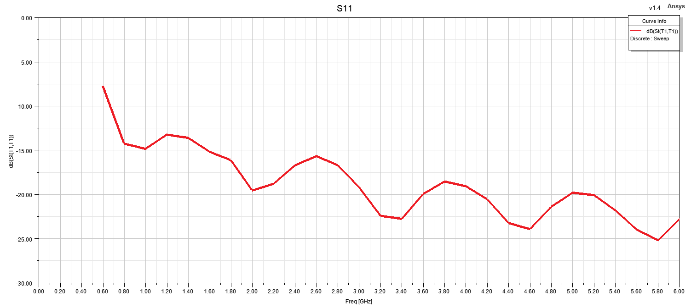

## VSWR

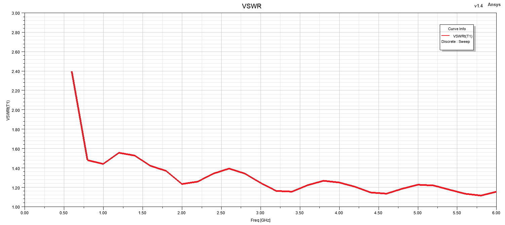

## Realized Gain

## Axial Ratio vs Frequency

## Cross Polar Discrimination (XPD)

## Radiation Patterns

### 1 GHz

<table>
<tr>
<td align="center">
  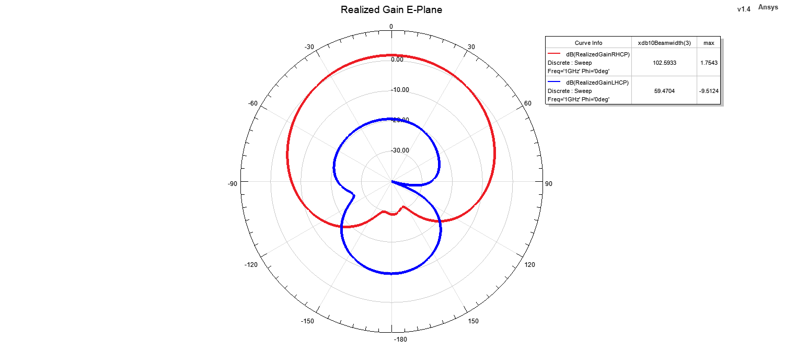
</td>
<td align="center">
  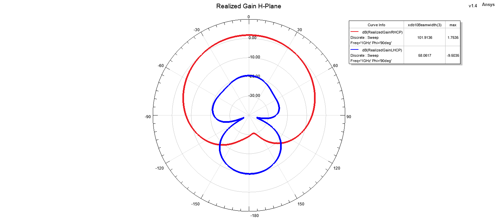
</td>
</tr>
<tr>
<td align="center">
  
</td>
<td align="center">
  
</td>
</tr>
</table>

### 2 GHz

<table>
<tr>
<td align="center">
  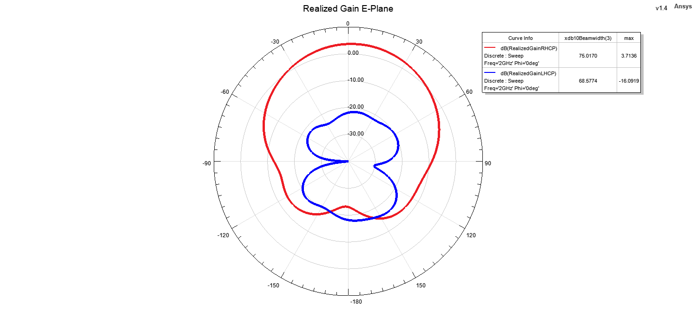
</td>
<td align="center">
  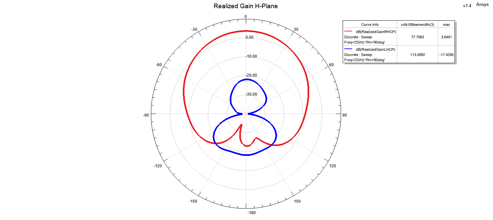
</td>
</tr>
<tr>
<td align="center">
  
</td>
<td align="center">
  
</td>
</tr>
</table>

### 3 GHz

<table>
<tr>
<td align="center">
  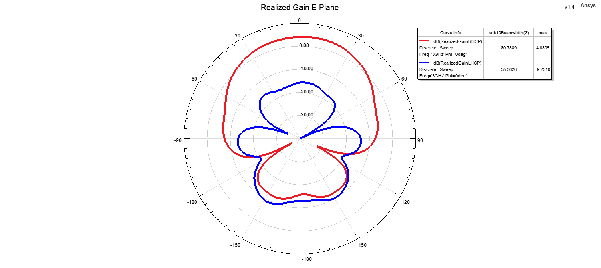
</td>
<td align="center">
  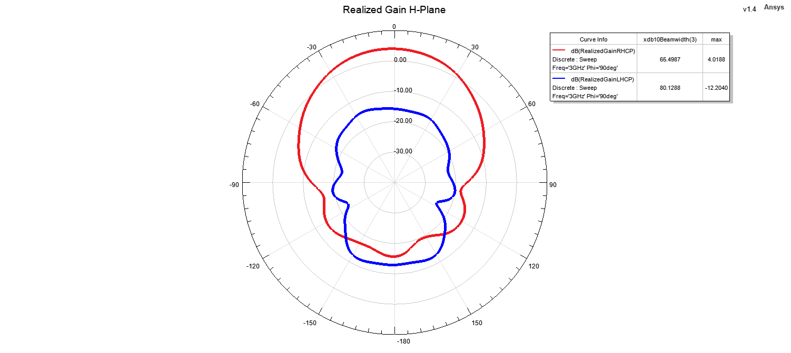
</td>
</tr>
<tr>
<td align="center">
  
</td>
<td align="center">
  
</td>
</tr>
</table>

### 4 GHz

<table>
<tr>
<td align="center">
  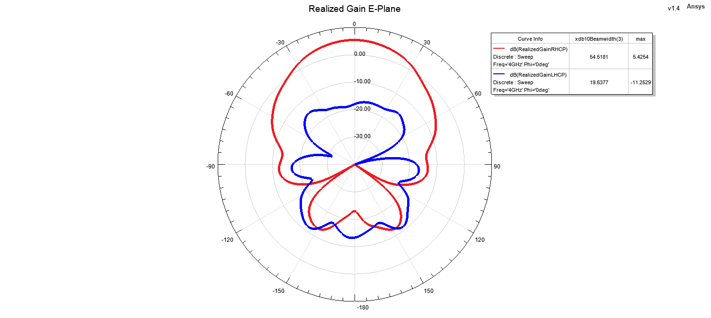
</td>
<td align="center">
  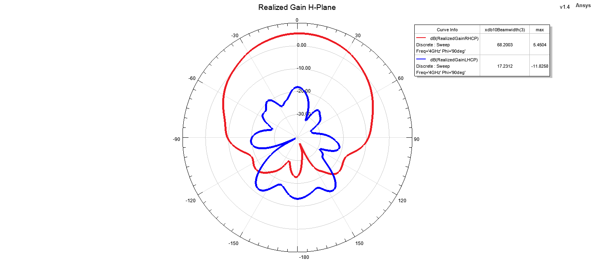
</td>
</tr>
<tr>
<td align="center">
  
</td>
<td align="center">
  
</td>
</tr>
</table>

### 5 GHz

<table>
<tr>
<td align="center">
  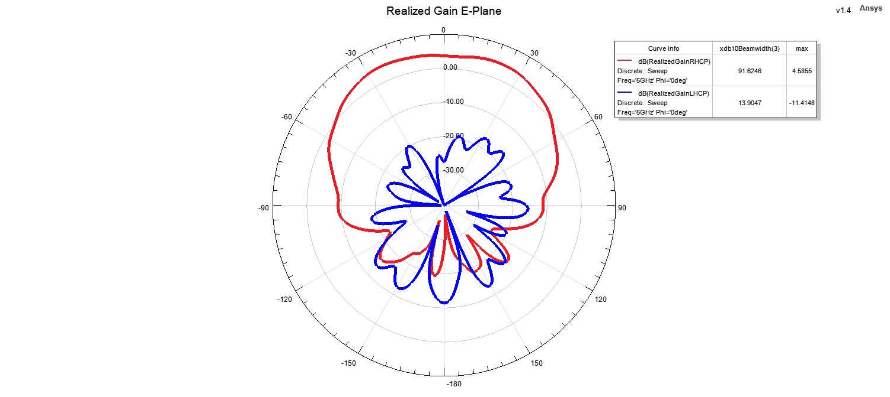
</td>
<td align="center">
  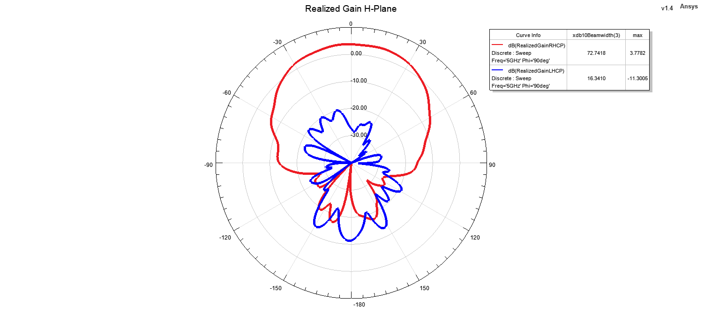
</td>
</tr>
<tr>
<td align="center">
  
</td>
<td align="center">
  
</td>
</tr>
</table>

### 6 GHz

<table>
<tr>
<td align="center">
  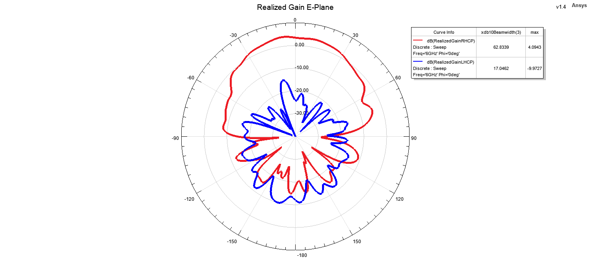
</td>
<td align="center">
  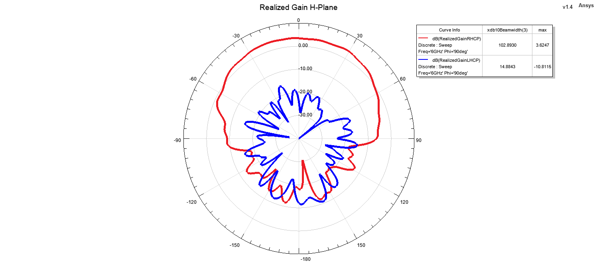
</td>
</tr>
<tr>
<td align="center">
  
</td>
<td align="center">
  
</td>
</tr>
</table>
